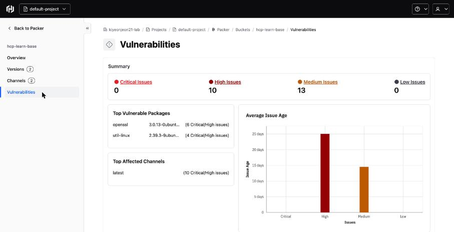

# 02. HCP Packer

[← 목차](./)

HCP Packer는 이미지를 직접 저장하지 않는다.
Packer가 만든 이미지(AMI, Docker 이미지 등)의 **메타데이터**를 모아 두는 레지스트리다.
"어떤 이미지가 최신이고, 어떤 이미지를 프로덕션에 써도 되는가"를 중앙에서 관리하는 게 목적이다.

AWS에 AMI를 굽는 건 실제 돈이 들어서, 로컬 Docker 빌더로 진행했다.
HCP Packer는 빌더 종류를 가리지 않는다.

## 레지스트리 만들기

포털 Packer 페이지에서 "Create a free registry" 버튼 하나로 끝난다.
레지스트리는 프로젝트당 하나다.

## 템플릿: `hcp_packer_registry` 블록

```hcl
build {
  name = "hcp-learn-base"

  hcp_packer_registry {
    bucket_name = "hcp-learn-base"
    description = "Ubuntu 24.04 + nginx, built locally with the docker builder"
    bucket_labels = { os = "ubuntu", owner = "hcp-learn" }
    build_labels  = { version = var.version_label, "build-time" = timestamp() }
  }

  sources = ["source.docker.ubuntu"]

  provisioner "shell" {
    inline = [
      "apt-get update -qq",
      "DEBIAN_FRONTEND=noninteractive apt-get install -y -qq nginx",
      "echo 'hello from hcp-learn ${var.version_label}' > /var/www/html/index.html",
    ]
  }
}
```

전체 템플릿은 [`packer/base.pkr.hcl`](https://github.com/kiyeonjeon21/hcp-learn/blob/main/packer/base.pkr.hcl).

인증은 환경변수 `HCP_CLIENT_ID`, `HCP_CLIENT_SECRET`, `HCP_PROJECT_ID`만 있으면 된다.

```bash
packer init . && packer build -var version_label=v1 .
# --> Published metadata to HCP Packer registry packer/hcp-learn-base/versions/01M85Z...
```

용어 정리:

- **Bucket**: 이미지 한 종류 (`hcp-learn-base`).
- **Version**: `packer build` 한 번의 결과. fingerprint로 식별한다. git 저장소 안이면 커밋 해시를 쓰고, 아니면 ULID를 자동 생성한다.
- **Build / Artifact**: 버전 안의 플랫폼별 결과물. Docker면 platform/region이 둘 다 `docker`이고 identifier는 이미지 sha256이다.
- **Channel**: 특정 버전을 가리키는 이름표. `latest`는 자동으로 생긴다.

## 채널 승격을 Terraform으로

`hashicorp/hcp` provider (v0.115)로 `production` 채널을 만들고 버전을 지정했다.
state는 로컬에 두었다.

```hcl
resource "hcp_packer_channel" "production" {
  name        = "production"
  bucket_name = "hcp-learn-base"
}

resource "hcp_packer_channel_assignment" "production" {
  bucket_name         = hcp_packer_channel.production.bucket_name
  channel_name        = hcp_packer_channel.production.name
  version_fingerprint = var.production_fingerprint
}

# 다른 인프라 코드는 이렇게 "production 채널의 이미지"를 참조한다
data "hcp_packer_artifact" "production" {
  bucket_name  = "hcp-learn-base"
  channel_name = "production"
  platform     = "docker"
  region       = "docker"
}
```

v1을 production에 넣었다가 v2로 승격하니 `production_image` 출력이 v1 sha에서 v2 sha로 바뀌었다.
이미지를 쓰는 쪽 Terraform 코드는 그대로 두고, 채널만 옮기면 다음 apply 때 새 이미지로 간다.
이게 HCP Packer의 핵심 워크플로다.

## 폐기(Revoke)

v1에 문제가 있다고 치고 API로 폐기했다.

```bash
curl -X PATCH -H "Authorization: Bearer $T" \
  ".../packer/2023-01-01/organizations/$ORG/projects/$PROJ/buckets/hcp-learn-base/versions/<v1 fingerprint>" \
  -d '{"revoke_at":"2026-11-24T05:14:24Z","revocation_message":"CVE drill: v1 nginx is outdated"}'
```

상태가 `VERSION_REVOKED`가 되고, 이 버전을 채널에 다시 넣으려 하면 Terraform이 막는다.

```
Error: Error updating channel: version is revoked. Please ratify the version before
trying to assign it to a channel or assign the channel to another non-revoked version.
```

`hcp_packer_artifact` 데이터 소스도 폐기된 버전을 가리키면 실패하므로, 폐기된 이미지로 새 인프라가 뜨는 걸 막을 수 있다.

## 티어: Essentials vs Standard

SBOM을 올리려고 `hcp-sbom` provisioner를 넣었더니 업로드에서 실패했다.

```
HCP Packer Sbom Storage is not available for the registry Essentials tier.
Please, upgrade your registry to upload and download SBOMs
```

포털 Packer → Settings → Pricing에서 바꿀 수 있다.

| 포털 표기 | API 값 | 주요 기능 |
| --- | --- | --- |
| Essentials (무료) | `STANDARD` | 레지스트리, 골든 이미지, Terraform 연동 |
| Standard (유료) | `PLUS` | 예약 폐기, 컴플라이언스 체크, SBOM/취약점, Run task, Audit logs |

포털 이름과 API 이름이 한 칸씩 어긋나 있어서 헷갈린다.
Standard로 올리자 사이드바에 **Run task (Beta)**와 **Audit Logs** 메뉴가 새로 생겼다.

## SBOM과 취약점 스캔

이미지 안에서 syft로 SBOM을 만들고 `hcp-sbom` provisioner로 올린다.

```hcl
provisioner "shell" {
  inline = [
    "curl -sSfL https://raw.githubusercontent.com/anchore/syft/main/install.sh | sh -s -- -b /usr/local/bin",
    "/usr/local/bin/syft scan dir:/ --exclude ./proc --exclude ./sys -o spdx-json=/tmp/sbom.spdx.json -q",
    "rm /usr/local/bin/syft",
  ]
}

provisioner "hcp-sbom" {
  source    = "/tmp/sbom.spdx.json"
  sbom_name = "base-os"
}
```

v3를 빌드하자 버킷의 Vulnerabilities 탭에 바로 결과가 떴다.



- Critical 0, High 10, Medium 13.
- 가장 취약한 패키지: `openssl 3.0.13`, `util-linux 2.39.3`.
- 영향받는 채널: `latest`.
- `GO-2026-*` 항목은 Ubuntu 패키지에는 Go 바이너리가 없으니, `/`를 스캔하는 순간 `/usr/local/bin/syft` 자신이 SBOM에 들어간 것으로 보인다.
  실제로 쓸 때는 `--exclude ./usr/local/bin/syft`를 주거나 syft를 이미지 밖에서 돌려야 한다.

이미지 하나당 CVE 현황을 채널 단위로 보여 주니, "프로덕션 채널에 High가 몇 개 있나"를 바로 알 수 있다.

## 느낀 점

- 레지스트리 자체는 무료 티어로도 충분히 쓸 만하다. 채널 + 폐기 + Terraform 데이터 소스 조합이 핵심이다.
- 빌드 결과물은 그대로 내 클라우드/로컬에 있고, HCP에는 메타데이터만 올라간다.
- SBOM, 취약점, 예약 폐기 같은 거버넌스 기능은 Standard 티어부터다.
